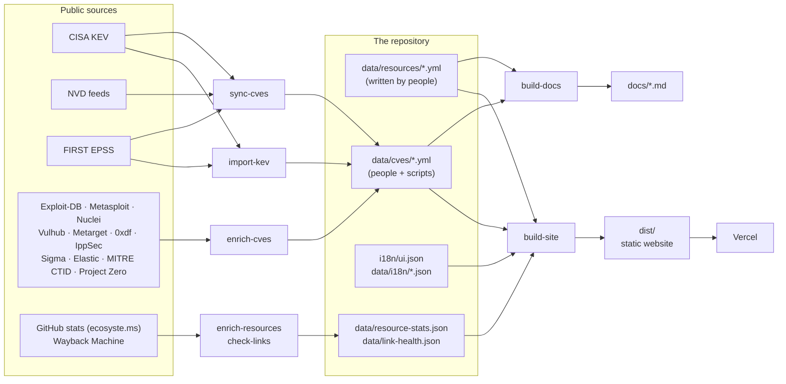

# How Hexicon works

This document explains the whole project, from the idea to the code, so that a new contributor or maintainer can find their way around. You don't need to read it to *use* Hexicon; for that, just open the [website](https://hexicon-murex.vercel.app).

**Contents:** [The idea](#1-the-idea) · [The big picture](#2-the-big-picture) · [The data](#3-the-data) · [The CVE pipeline](#4-the-cve-pipeline) · [Keeping things fresh](#5-keeping-things-fresh) · [The website](#6-the-website) · [Languages](#7-languages) · [Automation](#8-automation-and-deployment) · [Common tasks](#9-common-tasks) · [Design decisions](#10-design-decisions)

---

## 1. The idea

Security knowledge is scattered across thousands of blogs, repos, courses and advisories. Newcomers don't know where to start; practitioners waste time checking whether a link is still alive or a CVE is really exploited.

Hexicon does two things:

1. **A library**: 533 hand-picked resources (courses, tools, books, labs, cheatsheets, papers, certifications…) in 14 domains, each described, tagged by level and cost, and checked weekly.
2. **A CVE field guide**: 1,116 pages for the vulnerabilities attackers actually exploit (from the CISA KEV catalog), each answering *What is it? Am I affected? Is it exploited? How do I check, practise, detect and fix it?*

Everything is available in English, German, French, Arabic and Russian.

## 2. The big picture

Hexicon has **no server and no database**. The source of truth is a folder of small YAML files. Scripts turn them into a static website and Markdown docs.



In short: **people write YAML → scripts add official data and intel → the build turns it into a website**.

## 3. The data

### Resources: `data/resources/<domain>/<slug>.yml`

One file per resource, written by people. Example:

```yaml
title: "Arkime"
url: "https://arkime.com/"
type: tool                      # course, tool, book, lab, cheatsheet, paper, certification, …
domain: defensive               # one of the 14 domains in data/taxonomy.yml
subdomains: [network-defense]
level: [intermediate]           # beginner · intermediate · advanced
cost: free                      # free · freemium · paid
languages: [en]                 # languages the resource itself is in
description:
  en: "Large-scale indexed full packet capture and search."
  # de / fr / ar / ru optional; without them the site shows a generated, translated fallback line
tags: [full-packet-capture]
status: active                  # active · archived · unmaintained
featured: false
added_by: "@0xOmar-Ibrahim"
added_on: 2026-11-10
```

The rules live in [`schema/resource.schema.json`](schema/resource.schema.json). Domains, subdomains and their translations live in [`data/taxonomy.yml`](data/taxonomy.yml).

### CVE pages: `data/cves/<year>/CVE-*.yml`

Each CVE page has up to three layers, and **each layer has exactly one owner**:

| Layer | Fields | Who writes it |
|---|---|---|
| **Curated notes** | `nickname`, `summary` (5 languages), `affected`, `references`, `mitre_attack`, `tags` | People (18 hand-written pages so far, e.g. Log4Shell) |
| **Official facts** | `official:` CVSS, CWE, publish date, KEV status, ransomware use, EPSS | `sync-cves.mjs`, never by hand |
| **Intel** | `intel:` affected versions, exploits, scanners, labs, detections, ATT&CK, fix, priority | `enrich-cves.mjs`, never by hand |

Pages created by the importer (`source: kev-import`) also carry `rank` (position in the EPSS ranking) or `recent: true` (added to KEV in the last 180 days), a `vuln_type` (e.g. `rce`, `sqli`), and summaries generated in all five languages.

### Generated files (don't edit by hand)

| File | Written by | Contains |
|---|---|---|
| `data/resource-stats.json` | `enrich-resources.mjs` | GitHub stars / last push / archived, link status, health verdict per resource |
| `data/link-health.json` | `check-links.mjs` | Status of every URL on CVE pages, failure count, Wayback copy |
| `docs/*.md` | `build-docs.mjs` | Markdown views of each domain and the top CVE list |
| `docs/link-report.md`, `docs/cve-link-report.md` | the two link checkers | What's broken, for maintainers |

## 4. The CVE pipeline

Three scripts run in order. Each one is safe to re-run and keeps what the others wrote.

### Step 1: choose the CVEs: `scripts/import-kev.mjs`

- Downloads the CISA KEV catalog (every CVE known to be exploited in real attacks) and FIRST EPSS scores (probability of exploitation in the next 30 days).
- Ranks KEV entries by EPSS and keeps the **top 1,000**, plus **every CVE added to KEV in the last 180 days**. New entries start with a low EPSS and would otherwise be missed.
- Classifies each CVE into a vulnerability type with [`scripts/vuln-types.mjs`](scripts/vuln-types.mjs), which also produces the translated names ("Remote code execution in …") and summaries.
- Never overwrites hand-written pages; only adds `rank` / `recent` to them.

### Step 2: official facts: `scripts/sync-cves.mjs`

- With `--feeds`, reads NVD's yearly JSON feeds (cached in `.cache/nvd`), streamed by [`scripts/lib-nvd.mjs`](scripts/lib-nvd.mjs) because the newest files are too large to load at once.
- Writes the `official:` block: CVSS score and vector, CWE, publish date, KEV date and ransomware use, EPSS score and percentile.

### Step 3: intel: `scripts/enrich-cves.mjs`

Builds the `intel:` block from public sources (downloads cached for a day in `.cache/enrich`):

| Question on the page | Source |
|---|---|
| Am I affected? | NVD CPE configurations → readable version ranges |
| Is a public exploit available? | Exploit-DB index, Metasploit module metadata (**titles and links only**) |
| Can I check my systems? | ProjectDiscovery Nuclei templates |
| Can I practise? | Vulhub and Metarget labs; retired Hack The Box machines via 0xdf write-ups and IppSec videos |
| How did the real attack work? | Google Project Zero root-cause analyses |
| Can I detect it? | SigmaHQ and Elastic detection rules, matched by **full rule content**, not file names |
| What does the attacker do? | MITRE CTID KEV → ATT&CK mappings; otherwise inferred from vulnerability type and attack vector (labelled *inferred*) |
| How do I fix it? | NVD patch / advisory references, CISA required action and due date (translated via `data/i18n/kev-actions.json`) |

It also computes a **patch priority**:

- **P1, patch immediately**: known ransomware use and CVSS ≥ 9, *or* EPSS ≥ 97% with CVSS ≥ 9 and a public exploit
- **P3, on schedule**: CVSS < 7 and no ransomware use
- **P2, this week**: everything else

The reasons (exploited, ransomware, high EPSS, critical CVSS, public exploit) are stored and shown next to the priority.

## 5. Keeping things fresh

Links rot and projects get abandoned. Two scripts check them weekly.

**`scripts/enrich-resources.mjs`** (library):
- Gets GitHub stars, last push and archived status for every resource hosted on GitHub (via the public ecosyste.ms API, no token needed).
- Checks every resource URL: HEAD, then GET, then `curl` as a fallback for TLS quirks.
- Verdict per resource: `maintained`, `stale` (no push in 2+ years), `archived`, or `broken` (dead on **two weekly checks in a row**, so one outage doesn't flag a good link).

**`scripts/check-links.mjs`** (CVE pages):
- Checks every URL stored on the CVE pages (about 1,800), retries dead ones once more at the end of the run.
- Treats bot-protection answers (401 / 403 / 429 / 503) as alive, since a browser can open them.
- For dead links, looks up the closest **Wayback Machine** snapshot. The website then links the archived copy, labelled as such; links with no snapshot are hidden after two failed weekly runs.

## 6. The website

`site/` is plain HTML, CSS and JavaScript with no framework and no build tool.

**Build** (`scripts/build-site.mjs`) writes `dist/`:

| File | Used for |
|---|---|
| `data.json` | Domains, all resources (merged with quality signals) and the curated CVE notes |
| `ui.json` | Every label in 5 languages |
| `cves.<lang>.json` | Compact, per-language index of all ranked CVEs for the CVE table (loaded on demand) |
| `cve/<ID>.json` | Full record of one CVE, loaded when its detail page opens (dead links already swapped for archived copies) |

**Sections of the page** (`site/index.html` + `site/app.js`):

- **Start here**: three simple steps for newcomers.
- **Topics**: the 14 domains; clicking one opens it in the library.
- **Library**: topic sidebar, search, *Beginner* / *Free only* / *Hide unmaintained* filters, sort by *Recommended*, *Most popular* or *Recently updated*. Cards show type, level meter, cost, stars and "updated … ago", plus warnings for archived, stale or broken resources.
- **CVEs**: a searchable table of 1,114 ranked CVEs (filters: vendor, severity, ransomware, *Patch immediately only*, *New only*), deep-dive cards for the curated pages, and a **detail page** for every CVE (`?cve=CVE-…`, shareable, works with the back button and Escape).
- **Contribute**: one "Suggest a resource" button that opens the GitHub issue forms.

On phones the CVE table becomes cards, and sections appear even when the reveal animation can't run.

## 7. Languages

- **Interface**: every label is a key in [`i18n/ui.json`](i18n/ui.json) with values for `en`, `de`, `fr`, `ar`, `ru`. HTML uses `data-i18n="key"`, JavaScript uses `t('key')`. Arabic switches the page to right-to-left.
- **Content**: translatable fields are objects (`{ en, de, fr, ar, ru }`). The site picks the visitor's language and falls back to English, or to a generated translated description for resources.
- **Numbers and dates** use the browser's `Intl` APIs, so "★ 82.5k · updated 15 days ago" appears in the visitor's language and number format.
- **CISA instructions**: KEV's "required action" texts are translated in [`data/i18n/kev-actions.json`](data/i18n/kev-actions.json), keyed by the exact English text. All 1,115 are covered; a new one-off instruction shows in English (with a note) until it's added.
- The language is kept in the URL (`?lang=ar`) so a page can be shared in one language.

## 8. Automation and deployment

| Workflow | When | What |
|---|---|---|
| `ci.yml` | Every push and pull request | Builds the site and checks that `docs/` is up to date |
| `sync-cves.yml` | Mondays | `import:kev` → `sync:cves --feeds` → `enrich:cves` → `docs`, then commits the changes |
| `resource-health.yml` | Tuesdays | `enrich:resources` → `check:links`, then commits stats and reports |
| `pages.yml` | Manual only | Legacy GitHub Pages deploy (not used) |

The live site is on **Vercel**, which rebuilds on every push to `main` (including the bots' weekly commits) and includes Vercel Web Analytics.

## 9. Common tasks

| I want to… | Do this |
|---|---|
| Add a resource | Create `data/resources/<domain>/<slug>.yml` (copy an existing one), run `npm run build && npm run docs`, open a PR |
| Translate a resource | Add `de:` / `fr:` / `ar:` / `ru:` under its `description` |
| Translate the interface | Edit the matching key in each language block of `i18n/ui.json` |
| Hand-write a CVE page | Add `nickname`, `summary` and `references` to its file in `data/cves/<year>/`; leave `official` and `intel` alone |
| Translate a new CISA instruction | Add the exact English text as a key in `data/i18n/kev-actions.json`, then `npm run enrich:cves` |
| Fix a broken link | Look at `docs/link-report.md` or `docs/cve-link-report.md`, update the URL in the YAML |
| Refresh CVE data by hand | `npm run import:kev && npm run sync:cves -- --feeds && npm run enrich:cves && npm run docs` |
| See it locally | `npm run dev` → http://127.0.0.1:4321 |

## 10. Design decisions

- **YAML files instead of a database**: anyone can review a change in a pull request, history lives in Git, and hosting is free.
- **Static site instead of an app**: nothing to hack, nothing to pay for, fast everywhere. Large data (CVE details) is split into small files loaded on demand.
- **Each field has one owner**: people write curated notes; scripts own `official` and `intel`. Re-running a script never destroys human work.
- **Links, not exploit code**: exploit availability helps defenders prioritise, but Hexicon only stores titles and links to public sources, always with an authorized-testing note.
- **Labelled guesses**: inferred ATT&CK techniques, generated descriptions and archived links are always marked, so readers know what is official and what is derived.
- **Two strikes before "broken"**: one failed check is often a temporary outage; flagging only after two weekly failures keeps good links from being hidden.

---

Questions or ideas? Open an [issue](../../issues/new/choose) or see [CONTRIBUTING.md](CONTRIBUTING.md).
